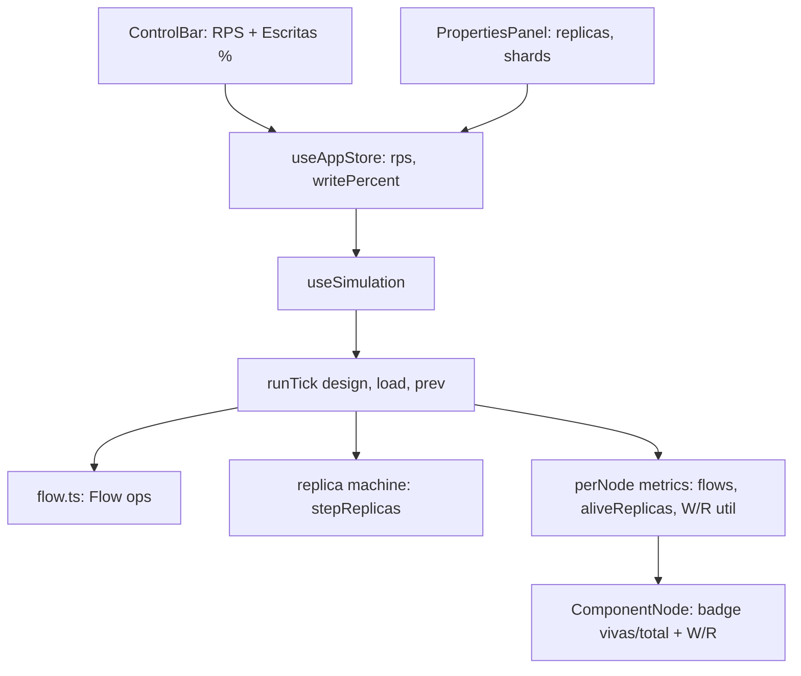

# Replicas + Mix Leitura/Escrita - Design

**Spec**: `.specs/features/replicas-rw-mix/spec.md`
**Context**: `.specs/features/replicas-rw-mix/context.md`
**Status**: Approved

---

## Architecture Overview

Abordagem escolhida: introduzir um tipo `Flow { read, write }` e substituir os escalares de RPS do `tick.ts` por `Flow`, mantendo a estrutura atual do algoritmo (passada topologica de propagacao + passada reversa de ratio/latencia). A maquina de saude e generalizada para uma maquina de replicas: em vez de derrubar o no inteiro, cada janela de sobrecarga derruba uma replica; o no esta down quando 0 replicas vivas.



Fluxo no tick:

1. Cliente emite `{read: rps x (1-w), write: rps x w}` onde w = writePercent/100.
2. Cada no processa seu Flow de entrada contra tetos efetivos (ver Data Models); excesso e erro por fluxo (conservacao por fluxo).
3. Distribuicao downstream preserva as regras atuais, agora sobre Flow: LB divide igualmente entre saudaveis; fan-out duplica; cache repassa `{read: miss de leitura, write: tudo}`; fila enfileira Flow e drena ate a capacidade efetiva (replicas vivas) dos consumidores.
4. Maquina de replicas roda por no: janela de sobrecarga (util > 150% por 30 ticks) mata UMA replica no mesmo tick; janela de recuperacao (util < 50% por 50 ticks) revive UMA. Com replicas=1, identico ao comportamento atual (mesmos limiares).
5. Passada reversa (ratio efetivo e latencia de caminho critico) permanece escalar sobre agregados; unica mudanca e a fracao de passagem do cache, que passa a ser `(missLeitura + escrita) / sucessoTotal`.

---

## Code Reuse Analysis

### Existing Components to Leverage

| Component | Location | How to Use |
| --------- | -------- | ---------- |
| Algoritmo do tick (topo + reversa) | `src/engine/tick.ts` | Manter estrutura; trocar escalares por Flow |
| Limiares de saude (1.5/30, 0.5/50) | `src/engine/tick.ts:4-7` | Reutilizar como limiares da maquina de replicas |
| PARAM_LIMITS + validacao generica | `src/engine/catalog.ts`, `useAppStore.updateParams` | Adicionar `replicas` e `shards`; validacao existente cobre limites |
| Field pattern do painel | `src/components/PropertiesPanel.tsx` | Novos campos numericos seguem o mesmo padrao |
| Validacao de import | `src/persistence/designStorage.ts:validateNode` | Estender lista de params opcionais |
| currentDesign consolidado | `src/store/useAppStore.ts` | Novos params fluem de graca para persistencia e avaliacao |

### Integration Points

| System | Integration Method |
| ------ | ------------------ |
| useSimulation | Passa `{rps, writeRatio}` do store para `runTick` |
| EvaluationPanel/openRouter | Prompt ganha secao de carga (RPS + escritas %) |

---

## Components

### engine/flow.ts (novo)

- **Purpose**: Tipo Flow e operacoes puras usadas pelo tick.
- **Interfaces**:
  - `interface Flow { read: number; write: number }`
  - `flowTotal(f): number`, `addFlow(a, b): Flow`, `scaleFlow(f, k): Flow`
  - `capFlow(f, maxTotal): Flow` - reduz os dois fluxos proporcionalmente para caber em maxTotal (retorna o que passa)
- **Dependencies**: nenhuma. **Reuses**: n/a.

### engine/tick.ts (modificado)

- **Purpose**: Propagacao dual-flow + maquina de replicas.
- **Interfaces**:
  - `runTick(design, load: { rps: number; writeRatio: number }, prev?): SimState` (assinatura muda; todos os call sites e testes atualizados)
  - interna `stepReplicas({ total, prevAlive, prevOverloadTicks, prevRecoveryTicks, utilization }): { alive, overloadTicks, recoveryTicks }`
- **Regras de teto por tipo** (alive = replicas vivas; tipos sem replicas tem alive fixo = 1):
  - generico: teto total = capacity x alive; utilizacao = total/teto
  - sql: tetoLeitura = capacity x alive; tetoEscrita = capacity x (alive > 0 ? 1 : 0); util = max
  - nosql: tetoLeitura = capacity x shards x alive; tetoEscrita = capacity x shards x (alive > 0 ? 1 : 0); util = max
  - cache/cdn: teto total como generico; hit ratio so sobre leitura
  - fila: enfileira Flow (profundidade interna por fluxo, `queueDepth` publico segue sendo o total); drain = soma capacity x alive dos consumidores saudaveis
- **Ordem no tick**: calcula utilizacao com alive do tick anterior -> aplica transicao de replica no mesmo tick -> processa com capacidade pos-transicao (consistente com AD "transicoes no mesmo tick").
- **Dependencies**: flow.ts, graph.ts. **Reuses**: estrutura e limiares atuais.

### engine/catalog.ts + engine/types.ts (modificados)

- `ComponentParams`: `replicas?: number` e `shards?: number`
- `PARAM_LIMITS`: `replicas {1,20}`, `shards {1,20}` (validacao adicional: inteiro)
- `DEFAULT_PARAMS`: `replicas: 1` em service, worker, cache, sql, nosql; `shards: 1` em nosql
- `REPLICABLE_TYPES` exportado (service, worker, cache, sql, nosql) para UI e engine
- `NodeMetrics` ganha: `aliveReplicas: number`, `totalReplicas: number`, `flows: { incoming: Flow; success: Flow; error: Flow }`, `readUtilization?: number`, `writeUtilization?: number` (bancos), `queueDepthFlow?: Flow` (interno para persistir profundidade por fluxo entre ticks)

### store/useAppStore.ts (modificado)

- `writePercent: number` (0-100, default 20) + `setWritePercent` com clamp
- `updateParams`: validacao de inteiro para replicas/shards (alem dos limites)

### UI (modificados)

- **ControlBar**: campo "Escritas (%)" ao lado do RPS (0-100)
- **PropertiesPanel**: campo "Replicas" nos tipos replicaveis; "Shards" no nosql; padrao Field existente
- **ComponentNode**: badge `xN` (parado) / `vivas/N` com cor de alerta quando vivas < N (rodando); bancos mostram `W util% | R util%` na linha de metricas

### persistence/designStorage.ts (modificado)

- `validateNode`: replicas/shards opcionais, inteiros, 1-20; ausentes = ok (default 1 no load)

### evaluation/openRouter.ts (modificado)

- `evaluateDesign(design, metrics, challenge?, load?: { rps: number; writePercent: number })`; prompt ganha secao "Carga da simulacao"

---

## Data Models

```typescript
interface Flow {
  read: number
  write: number
}

interface ComponentParams {
  capacity: number
  baseLatencyMs: number
  errorRate: number
  hitRatio?: number
  bufferSize?: number
  replicas?: number  // 1-20, tipos replicaveis; capacity e por replica
  shards?: number    // 1-20, so nosql
}
```

**Relationships**: `DesignNode.params` ja serializa `ComponentParams` inteiro — persistencia e payload de avaliacao herdam os campos novos sem mudanca de schema (schema segue 1, campos opcionais).

---

## Error Handling Strategy

| Error Scenario | Handling | User Impact |
| -------------- | -------- | ----------- |
| replicas/shards fora de 1-20 ou nao inteiro (painel) | `updateParams` retorna mensagem; valor nao aplicado | Erro inline no campo, como hoje |
| Import com replicas/shards invalidos | `validateNode` rejeita com "Parametro fora dos limites" | Mensagem de import invalido |
| Escritas (%) fora de 0-100 | Clamp no store | Valor ajustado silenciosamente (igual RPS) |
| Design antigo sem replicas/shards | Default 1 no load | Nenhum |

---

## Risks & Concerns

| Concern | Location | Impact | Mitigation |
| ------- | -------- | ------ | ---------- |
| `runTick` ja e denso (150+ linhas, 4 casos especiais); dual-flow aumenta | `src/engine/tick.ts` | Manutencao e risco de regressao | Extrair flow.ts e stepReplicas; testes de conservacao por fluxo em todos os tipos |
| Mudanca de assinatura de `runTick` quebra call sites | `src/hooks/useSimulation.ts`, `tick.test.ts` | Compilacao falha se esquecer | Task dedicada de migracao; tsc no gate |
| `queueDepth` publico vs profundidade por fluxo | `tick.ts` fila | Divergencia entre total e soma dos fluxos | Invariante testado: queueDepth === read+write do queueDepthFlow |
| Validacao de inteiro nao existe no fluxo generico de params | `useAppStore.updateParams`, `designStorage.validateNode` | 2.5 replicas passaria como valido | Checagem explicita Number.isInteger para replicas/shards nos dois pontos |
| Testes existentes assumem fluxo unico | `tick.test.ts` (65+ asserts) | Atualizacao em massa com risco de afrouxar testes | Migrar com writeRatio=0 onde o cenario era neutro; novos cenarios R/W em testes novos |

---

## Tech Decisions (only non-obvious ones)

| Decision | Choice | Rationale |
| -------- | ------ | --------- |
| Assinatura runTick | `runTick(design, { rps, writeRatio }, prev?)` | Carga virou composta; objeto evita parametro posicional ambiguo |
| Ratio/latencia reversa | Continua escalar (agregado) | Metricas globais nao precisam de quebra por fluxo; evita dobrar a passada reversa |
| Primaria viva | Teto de escrita zera so quando alive=0 | Nao modelamos qual replica morreu; alive>0 implica primaria operante (simplificacao didatica) |
| writePercent nao persiste no design | Controle de simulacao, como RPS | Decisao de contexto; schema inalterado |
| Badge com dado de simulacao | vivas/total vem de NodeMetrics, xN de params quando parado | Mesma fonte usada pelas metricas existentes (intervalo 250ms) |
