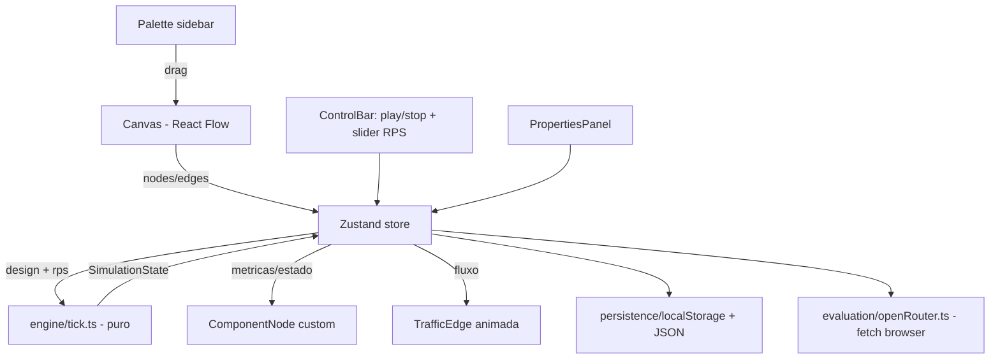

# Simulador de System Design - Design

**Spec**: `.specs/features/simulator-mvp/spec.md`
**Status**: Draft

---

## Abordagens consideradas

| Abordagem | Pros | Contras | Decisao |
| --------- | ---- | ------- | ------- |
| A (recomendada): Engine puro em TS + React Flow + Zustand, tudo no main thread | Simples, testavel (engine sem dependencia de React), Zustand ja e a base do React Flow | Tick roda no main thread (ok para grafos pequenos) | ESCOLHIDA |
| B: Engine em Web Worker | Nao bloqueia UI em grafos enormes | Complexidade de mensageria sem necessidade real (grafos didaticos tem < 50 nos) | Rejeitada (overengineering) |
| C: Canvas custom (SVG/Canvas API) | Controle total | Reimplementar drag/zoom/pan/conexoes que o React Flow ja da pronto | Rejeitada |

## Architecture Overview

App 100% client-side: Vite + React 18 + TypeScript. O motor de simulacao e um modulo TypeScript puro (funcoes puras, sem React), o que permite testes unitarios diretos dos ACs. A UI observa o estado via Zustand.



Loop de simulacao: `setInterval` de 100ms (10 ticks/s) chama `runTick(design, rps, prevState)` e grava o resultado no store. A UI de metricas re-renderiza por seletores do Zustand (nos so re-renderizam quando seus proprios numeros mudam).

## Code Reuse Analysis

Projeto greenfield - reuso vem de bibliotecas verificadas via Context7/doc oficial:

| Recurso | Fonte | Uso |
| ------- | ----- | --- |
| Canvas de nos, drag-and-drop, conexoes | `@xyflow/react` v12 | `ReactFlowProvider`, `screenToFlowPosition` no onDrop, `nodeTypes`, `isValidConnection` |
| Prevencao de ciclos | `getOutgoers` (React Flow) | Padrao oficial documentado em reactflow.dev/examples/interaction/prevent-cycles |
| Estado global | `zustand` | Store unico: design + estado da simulacao |
| Chamada IA no browser | OpenRouter REST API | `fetch` para `/api/v1/chat/completions` com Bearer token e model ID configuravel |
| Testes | `vitest` | Engine puro = testes diretos dos ACs |

## Components

### engine (puro, sem React)

- **Purpose**: Calcular um tick da simulacao de forma deterministica
- **Location**: `src/engine/`
- **Interfaces**:
  - `runTick(design: Design, rps: number, prev: SimState): SimState` - funcao pura principal
  - `topoOrder(design: Design): NodeId[]` - ordem topologica (Kahn), recalculada so quando o grafo muda
  - `canConnect(sourceType, targetType): boolean` - matriz de conexoes
- **Dependencies**: nenhuma
- **Files**: `types.ts`, `catalog.ts` (defaults + matriz), `tick.ts`, `validation.ts`

Algoritmo do tick (3 passes sobre a ordem topologica):

1. **Forward (carga)**: Cliente emite `rps`. Cada no soma o que recebe dos upstreams. `processed = min(incoming, capacity)`; `overflow = incoming - processed`; `baseErrors = processed * errorRate`; `localSuccess = processed - baseErrors`. Propagacao para downstream: LB divide `localSuccess` igualmente entre destinos saudaveis; Cache/CDN propagam so os misses (`localSuccess * (1 - hitRatio)`); Fila enfileira (buffer) e drena `min(buffer, drainRate)` para o consumidor; demais replicam `localSuccess` para cada destino.
2. **Estado**: `utilization = incoming / capacity`. Verde `< 0.7`; amarelo `0.7-1.0`; vermelho `> 1.0`. Down: `utilization > 1.5` por 30 ticks (3s); recuperacao: `incoming < 0.5 * capacity` por 50 ticks (5s). O estado efetivo e calculado antes do processamento local, portanto queda e recuperacao valem no mesmo tick reportado. No down: `processed = 0`, tudo que chega falha.
3. **Backward (sucesso e latencia efetivos)**: em ordem topologica reversa.
   `successRatio(n) = localRatio(n) * downstreamRatio(n)`, onde downstreamRatio e: media ponderada nos destinos (LB); `hit + miss * ratio(downstream)` (Cache/CDN); produto dos destinos (fan-out replicado); `1` para Fila (enfileirar = sucesso, semantica assincrona) e sinks (SQL/NoSQL/S3).
   `latencia(n) = latBase(n) * mult(u) + downstreamLat(n)`: LB e fan-out usam o maior ramo saudavel (caminho critico); Cache/CDN ponderam hit/miss; Fila nao soma latencia downstream.
   `effectiveErrorRps(n) = incomingRps(n) * (1 - successRatio(n))` registra falhas ponta-a-ponta para a UI, sem substituir `errorRps`, que continua representando erros locais e preserva a conservacao do forward pass.
   `mult(u)`: `1` se `u < 0.7`; rampa linear `1 -> 5` entre `0.7` e `1.0`; teto `5` acima.
   Metricas globais = successRatio e latencia do(s) Cliente(s).

### catalog (defaults por tipo)

| Tipo | Capacidade (RPS) | Latencia base | Parametros extras |
| ---- | ---------------- | ------------- | ----------------- |
| Cliente | - (fonte) | 0 | rps por cliente (via slider global) |
| CDN | 100.000 | 10ms | hitRatio 90% |
| Load Balancer | 50.000 | 2ms | - |
| API Gateway | 20.000 | 5ms | - |
| Service | 2.000 | 20ms | - |
| Cache | 50.000 | 1ms | hitRatio 80% |
| SQL | 500 | 10ms | - |
| NoSQL | 5.000 | 5ms | - |
| Fila | 10.000 (enqueue) | 1ms | buffer 100.000 msgs |
| Object Storage (S3) | 5.000 | 30ms | - |

Taxa de erro base: 0% em todos (configuravel 0-100%). Limites de edicao: capacidade 1-1.000.000; latencia 0-10.000ms; ratios 0-100%.

Matriz de conexoes (origem -> destinos validos):

| Origem | Destinos |
| ------ | -------- |
| Cliente | CDN, LB, Gateway, Service |
| CDN | LB, Gateway, Service |
| LB | Gateway, Service |
| Gateway | LB, Service |
| Service | Service, Cache, SQL, NoSQL, Fila, S3 |
| Cache | SQL, NoSQL, S3 |
| Fila | Service |
| SQL / NoSQL / S3 | (sink - sem saida) |

Cliente nao aceita entrada. Ciclos rejeitados via `getOutgoers` (padrao oficial React Flow).

### store

- **Purpose**: Estado global unico (design + simulacao + UI)
- **Location**: `src/store/useAppStore.ts` (Zustand)
- **Interfaces**: `nodes`, `edges`, `simState`, `rps`, `running`, acoes (`addNode`, `updateParams`, `startSim`, `stopSim`, `setRps`, `applyTick`, `loadDesign`)
- **Reuses**: padroes `useNodesState`-equivalentes do React Flow adaptados ao store

### ui

- **Location**: `src/components/`
- `Palette.tsx` - sidebar com os 10 componentes, `onDragStart` com o tipo
- `Canvas.tsx` - wrapper do `ReactFlow` com `onDrop`/`onDragOver`/`screenToFlowPosition`, `isValidConnection`, `nodeTypes`, `edgeTypes`
- `ComponentNode.tsx` - no customizado: icone, nome, cor por estado (verde/amarelo/vermelho/cinza-down), metricas (util%, RPS, lat, err%)
- `TrafficEdge.tsx` - edge customizada: pontos SVG animados via `animateMotion` no path; velocidade/densidade proporcional ao fluxo; oculta quando fluxo = 0
- `PropertiesPanel.tsx` - parametros do no selecionado com validacao de limites
- `ControlBar.tsx` - iniciar/parar, slider RPS (escala log, 1-100.000), metricas globais
- `SaveLoadDialog.tsx`, `SettingsDialog.tsx` (chave e modelo OpenRouter), `EvaluationPanel.tsx`

### persistence

- **Purpose**: Salvar/carregar/exportar/importar designs
- **Location**: `src/persistence/designStorage.ts`
- **Interfaces**: `saveDesign(name, design)`, `listDesigns()`, `loadDesign(name)`, `deleteDesign(name)`, `exportJson(design)`, `importJson(text): Design | ValidationError`
- Schema JSON versionado (`{schema: 1, nodes, edges}`); import valida tipos, parametros dentro dos limites e conexoes contra a matriz; falha de localStorage capturada e reportada sem perder o estado em memoria

### evaluation

- **Purpose**: Avaliacao do design por IA
- **Location**: `src/evaluation/`
- **Interfaces**: `evaluateDesign(design, metrics, challenge?): Promise<string>`
- OpenRouter via `fetch`; chave e model ID lidos do localStorage (nunca em codigo); timeout 60s; resposta em portugues; prompt = snapshot JSON do design + metricas da ultima simulacao + requisitos do desafio (2 desafios iniciais: URL shortener 10k RPS, feed de noticias 50k leituras/s)
- Erros mapeados para mensagens claras (chave invalida / rede / timeout)

## Data Models

```typescript
type ComponentType = "client" | "cdn" | "loadbalancer" | "gateway" | "service"
  | "cache" | "sql" | "nosql" | "queue" | "storage";

interface ComponentParams {
  capacity: number;      // RPS
  baseLatencyMs: number;
  errorRate: number;     // 0-1
  hitRatio?: number;     // cache/cdn, 0-1
  bufferSize?: number;   // queue
}

interface Design {
  schema: 1;
  nodes: { id: string; type: ComponentType; position: XY; params: ComponentParams }[];
  edges: { id: string; source: string; target: string }[];
}

type HealthState = "healthy" | "degraded" | "overloaded" | "down";

interface NodeMetrics {
  incomingRps: number; processedRps: number; successRps: number;
  errorRps: number; effectiveErrorRps?: number;
  utilization: number; effectiveLatencyMs: number;
  state: HealthState; queueDepth?: number;
  overloadTicks: number; recoveryTicks: number;  // contadores do estado down
}

interface SimState {
  perNode: Record<string, NodeMetrics>;
  global: { successRatio: number; e2eLatencyMs: number; totalRps: number };
}
```

## Error Handling Strategy

| Cenario | Tratamento | Usuario ve |
| ------- | ---------- | ---------- |
| Conexao invalida (matriz ou ciclo) | `isValidConnection` retorna false | Conexao nao fecha; tooltip com motivo no painel |
| Simular sem Cliente conectado | Guard no `startSim` | Mensagem orientando adicionar Cliente |
| Import JSON invalido | Validacao de schema antes de aplicar | Erro claro; canvas atual intacto |
| localStorage cheio/indisponivel | try/catch no save | Aviso; design permanece em memoria |
| API IA: chave invalida/rede/timeout 60s | try/catch tipado do SDK | Mensagem especifica por erro; design intacto |
| Delecao de no durante simulacao | Tick seguinte recalcula com grafo novo | Simulacao continua |

## Risks & Concerns

| Concern | Local | Impacto | Mitigacao |
| ------- | ----- | ------- | --------- |
| Chave API no localStorage (superficie XSS) | evaluation/ | Vazamento de chave se houver XSS | App sem scripts de terceiros; chave e do proprio usuario e revogavel; aviso na tela de configuracao |
| Re-render excessivo com tick de 100ms | ComponentNode | UI travada | Seletores Zustand por no + atualizacao visual de metricas throttled (250ms); animacao das edges via SVG/CSS, fora do ciclo React |
| Ordem topologica recalculada por tick | engine | Custo desnecessario | Cachear ordem; invalidar apenas em mudanca de grafo |

> Codigo existente: nenhum (greenfield).

## Tech Decisions

| Decisao | Escolha | Racional |
| ------- | ------- | -------- |
| Build | Vite | Padrao para SPA React, zero config |
| Estado | Zustand | Leve, integra bem com React Flow, seletores evitam re-render |
| Testes | Vitest | Nativo do ecossistema Vite; engine puro facilita TDD dos ACs |
| Modelo IA | Model ID OpenRouter configuravel | Usuario escolhe custo, provedor e capacidade sem alterar codigo |
| Animacao de trafego | SVG `animateMotion` na edge custom | Roda fora do React, custo baixo |
| Escala do slider RPS | Logaritmica | 1-100k util nas duas pontas |
```
