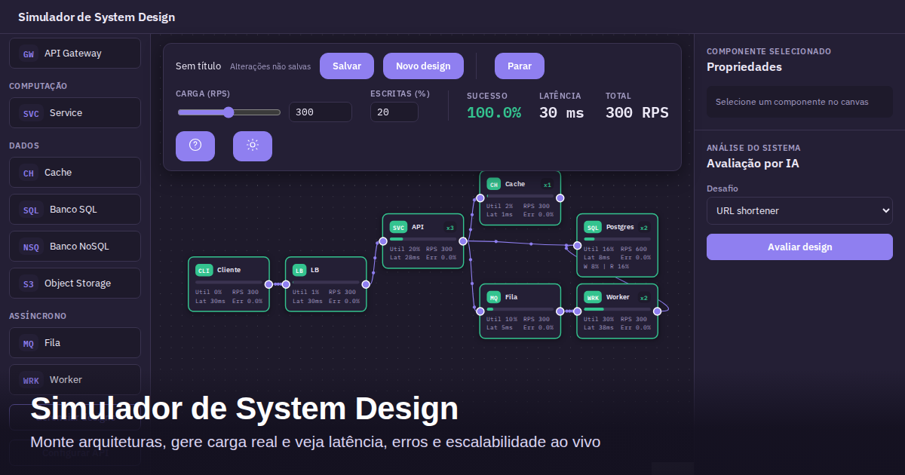

# System Design Simulator

Aprenda arquitetura de sistemas distribuídos montando e testando designs no
navegador. Conecte componentes, aumente a carga e observe latência, erros,
gargalos e escalabilidade — sem provisionar infraestrutura real.



[Contribuir](CONTRIBUTING.md) · [Segurança](SECURITY.md) · [Licença MIT](LICENSE)

## Recursos

- **Canvas interativo:** cliente, CDN, load balancer, API gateway, serviços,
  cache, filas, workers, bancos SQL/NoSQL e object storage.
- **Carga configurável:** requisições por segundo e proporção de leituras e
  escritas, com métricas de sucesso, latência e erros.
- **Escalabilidade e falhas:** réplicas, shards em NoSQL, degradação sob
  sobrecarga, reinício e autoscaling opcional nos componentes compatíveis.
- **Tecnologias e parâmetros:** presets e ajustes de capacidade, latência e
  outras propriedades por componente.
- **Designs persistidos:** salvar, carregar, renomear, excluir e importar ou
  exportar JSON, com proteção contra alterações não salvas.
- **Avaliação por IA opcional:** feedback sobre arquitetura, requisitos e
  métricas usando uma chave própria do OpenRouter.
- **Temas claro e escuro**, interface em português e execução client-side.

## Executar localmente

Recomendado: **Node.js 24 LTS** e npm.

```bash
git clone https://github.com/holocaster/system-design-simulator.git
cd system-design-simulator
npm ci
npm run dev
```

Abra o endereço informado pelo Vite, normalmente `http://localhost:5173`.
Não é necessário configurar uma API para usar a simulação.

### Primeiro design

1. Arraste os componentes da paleta para o canvas.
2. Conecte as saídas e entradas para montar o fluxo de tráfego.
3. Selecione os componentes e ajuste suas propriedades.
4. Configure RPS e percentual de escritas e inicie a simulação.
5. Observe os gargalos, altere a arquitetura e compare os resultados.

Use salvar/carregar para manter designs neste navegador ou exporte um JSON
para guardar uma cópia fora dele.

## Avaliação por IA

Em **Configurar API**, informe sua chave do OpenRouter e escolha um modelo.
A chave e a preferência de modelo ficam no `localStorage` do navegador.

Ao solicitar uma avaliação, o navegador envia a arquitetura, o enunciado,
a carga e as métricas ao OpenRouter; a chave é enviada para autenticar essa
requisição. O conteúdo é processado conforme o provedor/modelo escolhido,
e o uso pode gerar custos na sua conta.

**Não inclua segredos ou dados de produção nos designs ou enunciados.**
O `localStorage` não é um cofre de credenciais. Consulte a
[política de segurança](SECURITY.md) para mais cuidados.

## Limitações da simulação

Esta é uma ferramenta educacional, não um benchmark nem uma previsão de
capacidade de produção. Os resultados seguem um modelo determinístico e
simplificado; não executam os serviços ou bancos representados no canvas.
Valide decisões reais com medições e testes no ambiente de destino.

## Desenvolvimento e testes

Stack: React 19, TypeScript, Vite, React Flow e Zustand. A engine fica em
`src/engine/`, separada da interface e do estado da aplicação.

```bash
npm run build
npm run lint
npx vitest run
npm run e2e
```

O build inclui a verificação de tipos. Os testes unitários usam Vitest;
os testes de interface usam Playwright. Para preparar o Chromium e conferir
os requisitos dos testes, veja [CONTRIBUTING.md](CONTRIBUTING.md).

## Publicação e deploy

Este projeto usa `https://example.com` como domínio de exemplo. Antes de publicar
o site, substitua esse domínio em `index.html`, nos arquivos de `public/` e em
`e2e/seo.spec.ts`. Isso inclui canonical, Open Graph, JSON-LD, sitemap,
`robots.txt` e `llms.txt`.

O arquivo `deploy/nginx/system-design.conf.example` é um modelo: configure
domínio, porta, certificados e diretório de publicação antes de instalá-lo.
Ajuste também os diretórios em `deploy/build-and-run.sh` antes de executá-lo.
Os dados de infraestrutura nas especificações são exemplos, não uma
configuração de produção.

Para não expor seu e-mail no novo histórico Git, configure um nome público e
o e-mail `noreply` fornecido pelo GitHub antes do primeiro commit.

## Contribuir e reportar problemas

Encontrou um bug ou tem uma sugestão? Confira o
[guia de contribuição](CONTRIBUTING.md) antes de abrir uma issue ou PR.
Para vulnerabilidades, siga [SECURITY.md](SECURITY.md), sem divulgar detalhes
sensíveis em uma issue pública.

## Licença

Distribuído sob a [licença MIT](LICENSE). Dependências e assets de terceiros
continuam sujeitos às respectivas licenças.
